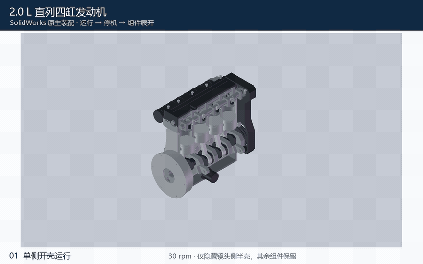
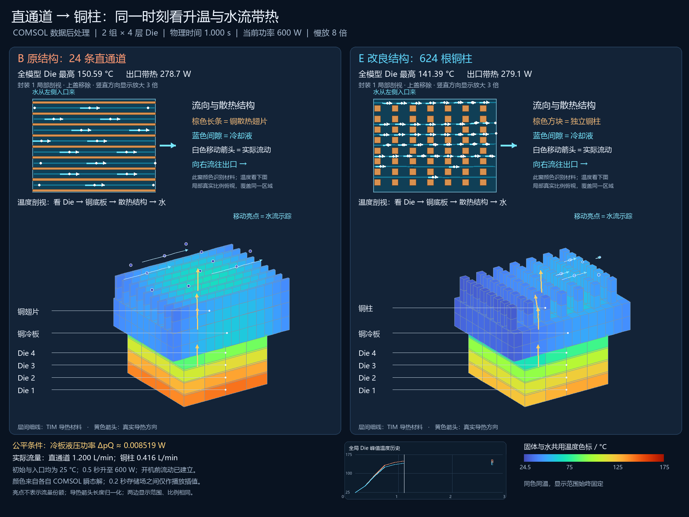

# EDS-Agent

工程设计与仿真研究工具包。Codex 直接负责理解目标、提出方案、选择实验、调用用户 MCP、
评价结果及提取经验；本仓库提供确定性的记录和检索工具，不内嵌第二个模型或 Agent 循环。

已提供 CAD 独立、CAE 独立及联合方法、版本化工程记录、产品基线接管、任务接续、
变更影响、个人数据根目录、活动预设、中央经验记录和 SQLite 中英文检索；
GraphQLite 可按需提供有界关系追溯。真实 CAD/CAE 操作通过用户选定的 VM/MCP 执行，
下面展示两个实际案例；具体操作、数值验证与产品验收分别记录。

## 实际运行效果

### CAD · 四缸发动机运行与爆炸展示

从原生零件、装配配合到曲柄连杆运动，构建约 **2.0 L 直列四缸发动机**：
37 种零件、116 个组件，包含缸体外壳、缸盖罩、油底壳和正时罩。
展示按“运行 → 停机 → 整体外观 → 零件展开”组织，便于看清机构和装配层次。
运行段仅隐藏朝向镜头一侧的四片外壳，背侧外壳、缸套和附件均保留；停机后恢复完整外观。



[观看发动机展示视频（MP4，10 秒，约 195 KB）](docs/media/demos/engine-motion-exploded.mp4) · 上方 GIF 约 1.11 MB。

本次在 SolidWorks 中重新计算运动并导出原生帧，已验证原生运动与交付包重开。当前是产品概念与机构展示，气门仍为静态示意；
爆炸位移用于讲解结构，不代表拆装工艺或制造放行。

### CAE · 多 Die 液冷：从结构迭代到真实升温对比

对 **两组 × 四层 Die、总热功率 600 W** 的液冷模型，Agent 从浅直道基线迭代到
加深直通道，再比较 **624 根铜柱**方案，并复核能量收支、网格敏感性和数值方法。
32 秒视频同时显示散热结构、液体流向和开机升温，结尾给出 COMSOL 原生热点对比。

[](docs/media/demos/liquid-cooling-comparison.mp4)

**[观看液冷对比视频（MP4，32 秒，约 1.6 MB）](docs/media/demos/liquid-cooling-comparison.mp4)**

在相同冷板液压功率约 **0.008519 W** 下，主比较的最高 Die 温度由 **167.84℃**
降至 **153.27℃**（降低 **14.57 K**）；压力阶次交叉复核得到 **155.55℃**，
仍较基线低 **12.29 K**。这是恒物性、单相条件下的数值演示与有限网格检查。
动画采用已建立的稳态流场和真实热瞬态数据，播放慢放不增加求解时间精度。

[两个案例的过程、来源与验证范围](docs/demo-gallery.md)

## 研究接续与经验复用

### 统一个人数据根目录

需要在多台电脑间沿用知识、活动预设和 Study 时，可将它们放在同一个
EDS 数据根目录。默认目录为 `~/EDS-Data`；显式 root 优先于
`EDS_DATA_HOME`、`~/.eds/config.json` 中的本机绑定，最后才回退到默认目录。

```powershell
python -m eds data init --user-id <stable-user-id>
python -m eds data status
python -m eds kb "@knowledge" sync
```

在新电脑上复制或由外部同步整个根目录后，运行 `python -m eds data use <root>`，
再执行 `kb "@knowledge" sync`（或 `rebuild`）重建本机索引。正式 Markdown、Study、
预设和 `assets/` 下明确选定的附件可以随根目录携带；SQLite、锁、凭据、后端绑定和
VM 绝对路径留在本机或需要重新绑定，根目录外的旧工程路径和大型 CAD 素材不会自动迁移。
这是便携目录约定，不是远端同步引擎或冲突合并器。
详见[个人数据根目录](docs/personal-data.md)。

已有产品也可以在同一数据根目录中建立可追溯的产品基线：先以渐进式图纸和文字
接管现状，再按固定基线派生 CAD/CAE Study。产品基线、附件哈希和声明不会替代
原始 Study，也不会把未记录的历史实验补写成事实；当前能力不自动解析 OCR、CAD
特征树或 CAE 设置。入口、引用和发布边界见[产品接管](docs/product-takeover.md)，
使用 `eds-study` 时仅在产品任务需要时读取[产品接管参考](skills/eds-study/references/product-takeover.md)。

受管 Study 的每轮工程迭代在形成 Assessment 后，可发布到个人根目录
`knowledge/iterations/` 的中央 `feedback` 历史；后续 CAD/CAE 任务按条件
检索这些方法适用性、路线、失败和修复经验，不必逐个遍历旧项目。论文方法、
参数优化讨论和工具执行经验同样纳入；原 Study 仍是事实来源，中央记录保留
版本、引用和哈希，方便未来生成检索、n-gram/PLE 或小基模训练数据。
具体记录边界见[统一工程经验记录](docs/experience-records.md)。

第一次了解这个工程，可先读[设计思路与分层协作](docs/design-overview.md)：其中用架构图、流程图和时序图说明研究闭环、逐级披露、子代理交接、知识分级以及 CAD/CAE 的组合方式。

也可查看 [架构设计与 RSI 演示文稿](EDS-Agent_架构设计与RSI.pptx)（17 页）。

## 本地使用

需要 Python 3.11+（当前验证环境为 Python 3.14）。EDS 记录与检索核心无第三方运行依赖；实际执行另需所选 Skill 和 MCP 的运行环境。需要关系检索时，可按[SQLite + GraphQLite 指南](docs/graph-knowledge.md)安装可选图索引；它不会替换现有 SQLite/FTS5，也不会改变默认检索路径。

### 给安装 Agent 的步骤

安装完整工程时同时初始化执行 Skill 的 submodule：

```powershell
git clone --recurse-submodules https://github.com/TuKJet/EDS-Agent.git
cd EDS-Agent
```

已有 checkout 则在仓库根目录执行：

```powershell
git submodule update --init --recursive -- execution-skills/solidworks-automation-skill execution-skills/cae-agent-hub
git submodule status
```

CAD 执行依赖 `execution-skills/solidworks-automation-skill/SKILL.md`，来自 `vm-sw-automation-skill` 分支，按主仓库 gitlink 锁定版本。
gitlink 固定公开基础提交，工程所需适配由本仓库 [patches/](patches/README.md) 保存，安装时自动应用；不要求把这些改动推到上游。补丁只保存差异，版本与验证边界见[执行 Skills](docs/execution-skills.md)。
使用 ZIP 下载而缺少 submodule 时，不能报告 CAD 安装完成；应取得带 submodule 的 Git checkout。
CAE 使用开源 CAE Agent Hub，源码已加入 `execution-skills/cae-agent-hub` 并固定版本。其通用 COMSOL MCP 文档为 `MCP/COMSOL/README.md`；正常调用只读取当前工具相关段落，安装时再读部署部分。仓库内 motor NVH Skill 仅适用于对应任务，不当作通用 CAE Skill。纯记录或离线任务可以省略执行端。

接着安装并核对 EDS 方法：

```powershell
python scripts/install_skills.py
python scripts/install_skills.py --check
python -m eds doctor
python -m eds study ./workspaces/my-study init --goal "研究支架的建模表达" --mode cad
python -m eds study ./workspaces/my-study resume
```

若要启用 GraphQLite 图检索，在隔离虚拟环境中安装可选依赖：

```powershell
python -m venv .venv
.\.venv\Scripts\Activate.ps1
.\.venv\Scripts\python.exe -m pip install -r requirements-graph.txt
python -m eds doctor --graph
```

macOS/Linux 使用 `source .venv/bin/activate`，再执行 `python -m pip install -r requirements-graph.txt`
和 `python -m eds doctor --graph`。后续图命令默认在这个已激活的虚拟环境中执行。
GraphQLite 0.9.4 提供 Windows x64、Linux x64/ARM64 和 Apple Silicon macOS 预编译包；
本次仅在 Windows 完成实际验证，Intel Mac 可能需要源码构建。版本与平台边界见
[SQLite + GraphQLite 指南](docs/graph-knowledge.md)。

安装会复制本工程的四个 Skills 到仓库 `.agents/skills/`，并自动核对、应用已初始化执行 submodule 的登记补丁；不更改全局 Codex 配置。
重复安装会识别已应用补丁；`--check` 只检查，待应用、版本不符或额外修改会返回失败。不要用强制 checkout/reset 绕过冲突。
只安装记录方法可用 `--execution none`；只需某个执行端时用 `--execution cad` 或 `--execution cae`，此时对应 submodule 缺失会报错。默认 `auto` 允许跳过未初始化的可选执行端，安装 Agent 必须据此报告缺口。
技能正文引用仓库文档，因此应保留完整 checkout；不要只复制一个 Skill 到其他项目。
可选的软件执行 Skill 或 MCP 实现放在 `execution-skills/` Git submodule 中，不复制其实现；安装结果分别报告 Skill、MCP 实现文档和初始化提示。当前 CAD 使用 `solidworks-automation-skill`，CAE 使用 CAE Agent Hub 的 COMSOL MCP；两者都须核对实际部署与任务适用范围。
Codex 可以直接读取本仓库 `AGENTS.md` 与技能源文件。原生发现由宿主负责，若未显示需刷新宿主。

**执行端安装验收：** 安装 Agent 先初始化对应 submodule，运行安装器并通过 `--check`，确认登记补丁已应用；只有在配置或验收该执行端时，才读取所选 submodule 的 `SKILL.md` 和安装/能力说明，并按其指引配置 MCP。普通研究讨论不会重复加载执行手册。可复用用户已有远程 VM/MCP；本地补丁不会自动部署到 VM。远端 MCP 必须部署这份已校验的补丁源码，或在远端取得本工程后运行同一安装器；单独拉取原始上游仓库不包含 EDS 补丁。部署后还须核对实际文件指纹、运行进程加载的版本，并验证具体操作。
EDS 的 CAD/CAE 方法会按阶段引导 Codex 加载执行 Skill，不依赖宿主自动发现嵌套 submodule；Skill 文档不自行发起 MCP 请求。
取得真实工具清单和本地绑定后，可针对本次需要的能力做轻量核对：

```powershell
python -m eds execution cad --backend local/cad-binding.json --tools local/cad-tool-names.json --capability inspect
python -m eds execution cae --backend local/cae-binding.json --tools local/cae-tool-names.json --capability results
```

普通检查只核对所选域、当前能力和记录的工具清单，不重建补丁、不检查其他后端，也不要求本次不用的全部领域能力。省略 `--capability` 时检查绑定中已声明的能力。安装、升级或源码排障时加 `--maintenance`，才检查所选执行源的固定版本、工作树和补丁；`--full` 只控制输出详情。实际调用仍须核对服务身份与目标工具 schema；本地检查不宣称 MCP 连通或具体操作通过。
分别报告「EDS 方法已安装」「执行 Skill 已加载」「MCP 已连接」「具体操作已验证」；未通过的阶段注明缺口，不统称安装成功或执行可靠。
凭据留在用户现有安全配置中。完整接入约定见 [执行 Skills](docs/execution-skills.md) 和 [后端绑定](docs/backend-integration.md)。

### 逐级读取与执行委派

先用 `eds-study` 和当前领域方法讨论目标、假设、候选和判据；联合问题先读 `eds-coupled`，不默认叠加所有方法。实验版本和固定输入确定后，执行者再读取[执行交接约定](skills/eds-study/references/execution.md)，只加载所选执行 Skill 的相关能力。这里的版本确定不是新增审批步骤。

执行者先发现已有连接和绑定。健康 MCP 使用[正常调用入口](skills/eds-study/references/execution-runtime.md)，只读取上游任务章节和参考；确认存在配置、连接或兼容性缺口时才进入[安装排障入口](skills/eds-study/references/execution-setup.md)的对应分支。未发现信息不等于未安装，不可达不等于需要重装；远程服务调用不要求在调用者本机安装 CAD/CAE 依赖。

复杂操作可交给使用独立上下文的原生 subagent，只传递本轮任务、固定输入、判据、预算和操作范围。主代理接收状态、实际偏差、观测量及单位、证据位置和待决策事项；完整手册、schema 和常规日志留在执行端。结果讨论只按需追读具体证据或质量参考，失败检查和未知状态不能在压缩中丢失。

接续命令 `resume` 默认只返回研究摘要、版本引用和任务状态，避免把执行历史重新灌入主对话。
需要核实某个结果时用 `show --ref <固定引用>`，执行者核实任务用 `show --run <run_id>`；
`resume --full` 保留完整接续视图，供明确需要详细记录时使用。
日常研究不要在摘要之后直接打开整个 `study.json`，这会重新载入全部记录；按引用取所需对象，完整文件仅在具体数据修复或诊断时查看。

在 Codex 中可请求：

> 使用 eds-study 和 eds-cad 接管 workspaces/my-study，先读取工程现状，提出能区分的候选并保存实验意图；确定实验后再加载对应执行 Skill，依据真实结果继续。

知识库位于独立目录，只收录明确登记的 Markdown 单元。格式与完整示例见
[知识示例](examples/knowledge/README.md)，不自动扫描磁盘或将 `doc/` 当作用户知识库。

```powershell
python -m eds kb ./workspaces/knowledge register method.md
python -m eds kb ./workspaces/knowledge route --question method-selection --stage planning
python -m eds kb ./workspaces/knowledge search "层流 pressure" --question method-selection --limit 5
python -m eds kb ./workspaces/knowledge read method-fluid-gap --version 1
python -m eds kb ./workspaces/knowledge read method-fluid-gap --version 1 --relation tested_by --depth 1 --max-units 5
python -m eds kb ./workspaces/knowledge sync
python -m eds kb ./workspaces/knowledge rebuild
```

关系问题可显式维护和查询本机图缓存：

```powershell
python -m eds kb ./workspaces/knowledge graph-sync
python -m eds kb ./workspaces/knowledge graph-status
python -m eds kb ./workspaces/knowledge graph-search "边界条件" --question method-selection --depth 2
```

也可在维护 SQLite 索引时显式加 `--graph`；图缓存不会在每次偏好、Study 或反馈写入时自动更新。
图索引缺失、过期或依赖未安装时，`graph-status` 仍返回诊断状态，`graph-search` 会报告原因；
安装依赖后，`graph-sync` 创建或更新图索引。普通 `search`、`read` 和现有 FTS5
检索仍可使用。完整边界、跨机同步和查询选择见[SQLite + GraphQLite 指南](docs/graph-knowledge.md)。

`method.md` 必须已经存在于指定知识目录并符合元数据约定。Markdown 保留事实与来源，
SQLite 为可重建派生数据；库不可用时 Codex 可继续使用当前工程和直接资料。

知识分为设计思路、方法、实验方案、验证反馈和工程偏好五种逻辑类别，共用现有存储。
先按具体问题选类，阶段作为后备，再结合领域、项目和用户范围检索；零命中不会自动扩成全库搜索。
默认回读只含选中单元全文与关联定位，相关正文需显式读取。旧无路由搜索保留为主动全库检索入口。
工程偏好单独记录使用者、适用范围和确认状态，日常检索只采用范围匹配的已确认条目；
它与 `once/auto/later/skip` 抽取频率不同。完整说明见[知识路由](skills/eds-study/references/knowledge.md)、
[分类纳管](skills/eds-study/references/knowledge-units.md)及[偏好管理](skills/eds-study/references/preferences.md)。

建模视图、工程图、CAE 场图和动画交付在制定执行计划前读取适用的已确认偏好。
活动预设用于减少重复检索：首次激活时固定适用的偏好版本，
后续任务直接使用预设快照；任务内覆盖只保存在当前 Run，只有显式保存为默认
才创建新的偏好版本。典型入口为 `python -m eds preset <knowledge-root>
activate|current|task|save-default`，再把 task 快照随 Run 输入传给执行端。
工程图执行端只把快照映射到其支持的 DrawingSpec 字段，并报告已应用和未映射项；
个人风格不会写入公共 Skill，工程硬约束也不会被快照覆盖。
具体命令、快照字段和首次激活约束见[活动预设说明](docs/execution-presets.md)。

视图与动画的 Run 还应固定可读性判据：结构与材料能辨认、方向清楚、量与单位明确、
色标和时间语义一致、来源可追溯，并检查代表帧与最终成片。这是 Codex 按 Skill
履行的执行交接义务，独立绕过 EDS 的 MCP 客户端不会自动获得这些上下文。

跨领域检索先区分通用实验流程和具体物理方法；默认少量候选、固定版本回读、按需追溯关系。
散热模型的材料值、液压预算和温降不能直接迁移到磁场或磨损任务；Graph 的路径命中
只提供查证线索，适用性由 Codex 对照条件判断。详见[跨领域复用与上下文预算](skills/eds-study/references/knowledge.md#cross-domain-transfer-and-context-budget)。

## 验证与执行接入

```powershell
python -m unittest discover -s tests -v
python -m compileall -q eds scripts tests
python scripts/demo_offline.py --output ./workspaces/offline-demo
python -m eds backend examples/backend.fixture.json check
```

离线演示生成三种 Study、执行状态历史、手动变更及影响报告、知识登记和检索结果。
`backend.fixture.json` 中所有工具名均为示例，不能直接作为真实工具配置。

- [工程记录与 API](docs/record-format.md)
- [后端绑定与 VM 信息](docs/backend-integration.md)
- [可选执行 Skills](docs/execution-skills.md)
- [三条路径验收与需求映射](docs/acceptance.md)
- [本地验证报告](docs/validation-report.md)
- [逐级披露与知识路由验证](docs/disclosure-and-knowledge-validation.md)
- [运行时检查精简与工程图路由验证](docs/runtime-lightweight-validation.md)
- [当前交付与剩余验收](docs/delivery-status.md)
- [CAD 实机验证与缺口](docs/live-cad-validation.md)
- [CAD 修复与候选复验](docs/live-cad-repair-validation.md)
- [CAE 实机验证](docs/live-cae-validation.md)
- [CAD/CAE 联合验收记录](docs/live-coupled-validation.md)
- [领域方法与解析自检](docs/methods.md)

开发依据是本地 `doc/` 需求；原目录保持原有 Git 忽略约定。可分发的实现说明在 `docs/`。
用户工程、原生文件、实际知识和私密后端配置应保存在独立工作区；`workspaces/` 和 `local/` 已忽略。
`output/` 保存本地产物，不随仓库上传；演示文稿的发布版单独保存在根目录。
历史验证报告中的 `workspaces/` 成果与原始日志链接指向本地留存证据，不随 GitHub 仓库分发；
公开仓库保留验证摘要、精选演示视频/GIF、测试及合成示例，可按上面的命令进行本地功能验证。
