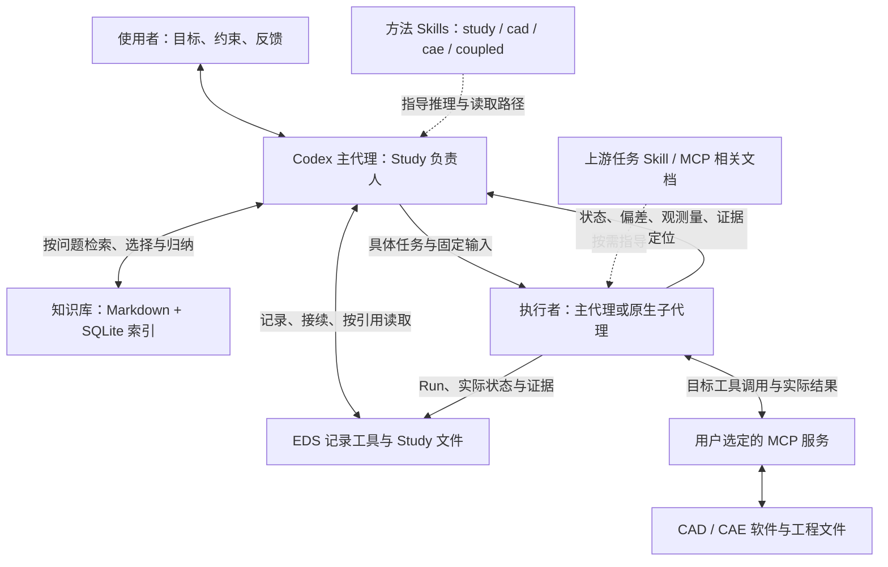
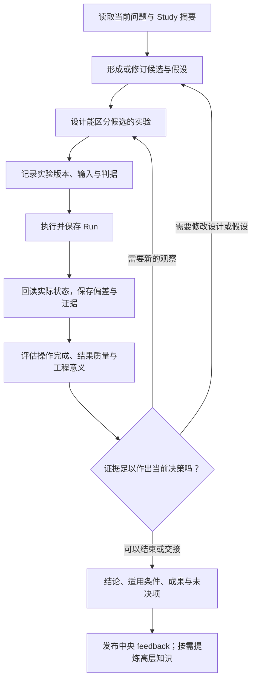
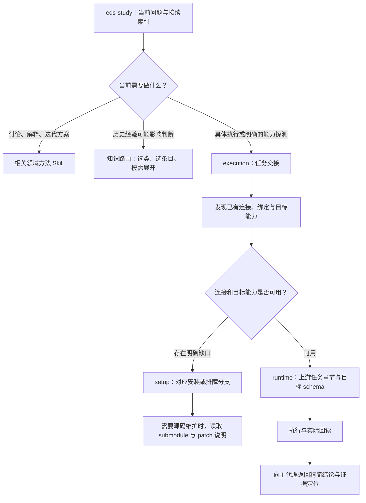
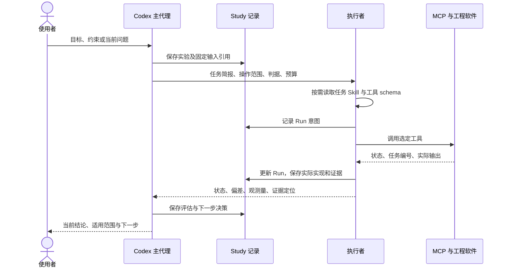
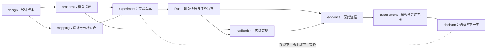
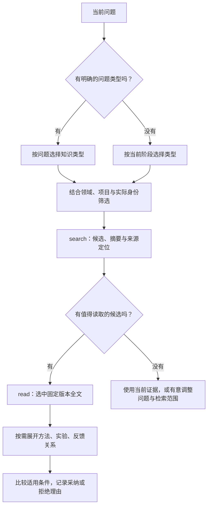

# EDS-Agent 的设计思路与分层协作

EDS-Agent 把一次工程研究组织成可继续、可比较、可追溯的过程：**人定义目标与约束，Codex 负责推理和决策，Skills 提供方法与操作指引，MCP 连接工程软件，记录与知识库保留过程和经验。**

本文面向第一次接触项目的使用者和开发者，说明这些部分为什么分开、如何交互，以及如何扩展。图中流程是协作方式；涉及推理、委派、解释和迭代的箭头由 Codex 推动，并不代表 `eds` 包内有一套自动运行的 Agent 引擎。

文中的 Mermaid 图可在 GitHub 或支持 Mermaid 的 Markdown 阅读器中显示。本说明是供人理解架构的入口，不是每次研究必须加载的 Skill 正文。

## 1. 从工程问题出发

一个 CAD/CAE 任务通常同时包含几种不同的问题：

- **目标与设计：** 要改善什么？结构、接口、成本和性能之间怎样取舍？
- **方法与假设：** 用什么物理模型或建模表达？哪些简化成立？
- **实验与判据：** 改什么、固定什么、观察什么，什么结果能区分候选方案？
- **软件执行：** 如何在选定 CAD/CAE 中创建、修改、求解、出图或导出？
- **解释与积累：** 实际结果说明什么？下一步做什么？哪些经验值得复用？

这些问题需要不同的信息。讨论物理假设时，软件安装手册通常没有帮助；准备工程图时，任务子 Skill 的能力边界和用户标注习惯才变得相关。项目据此将“研究判断”“执行操作”“事实记录”“可复用知识”分开，让每个阶段取得足够的信息。

## 2. 总体架构：职责分层，共用记录

| 部分 | 主要职责 | 保存或输出什么 |
| --- | --- | --- |
| 使用者 | 提供需求、限制、已有资料，参与重要取舍 | 目标、约束、工程反馈、明确偏好 |
| Codex 主代理 | 理解问题、提出候选、选择实验、解释结果、决定下一步 | 假设、实验方案、评估、决策 |
| EDS 方法 Skills | 提供领域思路、接续规则和条件式读取入口 | 指引，而非自动执行程序 |
| EDS 确定性工具 | 校验与保存版本、状态、关系；检索已登记知识 | Study 记录、索引、变更影响候选 |
| 执行者及上游能力 | 将已明确的任务落实到所选软件 | 实际模型状态、文件、数值、图像和运行证据 |

这里的层次是职责划分，不要求一层对应一个 Agent，也不要求每次任务都经过所有软件。简单任务可以由主代理完成；复杂的软件操作才有必要分给独立上下文的执行者。

`eds` 的核心是普通 Python 工具，没有内嵌模型客户端，也没有第二个研究循环。Skill 是 Codex 读取并遵循的说明；MCP 是调用外部软件能力的接口，二者承担不同职责。

## 3. 多层级交互：先确定问题，再逐步落实

人可以从任意层进入。例如，“比较两种散热思路”从目标和方法开始；“按现有模型出工程图”可直接进入执行准备；“这次结果为什么变了”从证据和解释开始。Codex 应补齐当前任务真正缺少的信息。

| 交互层级 | 人与 Codex 讨论的内容 | 阶段产出 | 此时通常需要的信息 |
| --- | --- | --- | --- |
| 目标层 | 要解决什么，限制是什么，怎样算有价值 | 问题、约束、已知事实和缺口 | 当前需求、相关设计经验 |
| 方法层 | 有哪些候选，其机制或表达差异是什么 | 候选设计、模型提议、假设及适用条件 | 领域方法、论文方法与相关反馈 |
| 实验层 | 哪个观察最能区分候选，如何控制条件 | 固定输入版本、变量、观测量、比较规则、预算 | 实验方法、必要能力探测 |
| 执行层 | 如何在选定工具中落实这一轮任务 | 实际实现、运行记录与原始成果 | 任务子 Skill、目标工具 schema、适用偏好 |
| 解释层 | 观察支持什么，还有哪些解释未排除 | 评估、结论范围、下一步或停止理由 | 选中证据、实际偏差、相关验证反馈 |
| 经验层 | 哪些内容对未来任务仍有用 | 带来源和条件的知识单元 | 本次记录、原始资料、分类纳管约定 |

这是一种可来回迭代的交互设计。例如，执行发现某个边界条件无法按预期实现，主代理需要回到方法或实验层处理，而不是让执行者自行改变假设后继续。常规操作细节由执行者处理，无须把每次工具调用都变成人的审批步骤。

## 4. 一轮研究怎样闭合

“记录实验版本”也称实验冻结，意思是保留这一轮到底要比较什么。它不是额外的人工审批，也不是把整个项目锁死。下一轮可以创建新版本，上一轮的输入和证据仍可追溯。

结果评价包含三个不同的问题：

1. **操作完成了吗？** 例如文件保存成功、求解任务结束。
2. **结果质量怎样？** 例如几何有效性、数值收敛、平衡检查或敏感性。
3. **它支持当前工程判断吗？** 例如实际工况是否匹配、简化假设是否适用、候选差异是否足够明确。

一次软件调用成功只回答第一个问题。后两个问题需要 Codex 结合当前目标、实际证据和相关方法判断。

## 5. 逐级披露：资料跟随问题展开

项目将主入口保持为简短索引，将操作和维护细节放在条件式参考中。阅读顺序由当前任务决定。

这种设计有三个具体效果：

- **研究讨论保持集中。** 目标、假设、判据与重要证据留在主上下文；常规日志、完整工具清单和软件手册留在执行上下文或文件中。
- **关联信息按需展开。** 知识搜索先给候选和定位；读中一个单元后，再决定是否读取相关方法、实验或反馈。
- **维护资料有明确入口。** 缺少连接信息时先发现现有配置；出现配置、认证、连接或兼容性问题时，再读取对应排障资料。明确要求安装或排障，也可直接进入该分支。

正常执行检查与维护检查也在代码上分开：`execution --capability <name>` 检查所选任务；`--maintenance` 才检查固定提交、工作树和补丁；`--full` 仅改变输出详细程度。这个分离减少了日常调用不需要的工作。

主上下文的精简不等于丢弃失败信息。影响判断的偏差、未知状态和未决问题需要保留摘要，并附可追读的证据位置。

## 6. 主代理与执行子代理怎样交接

复杂执行可以交给 Codex 原生子代理。主代理保留工程问题和决策权，执行者在给定范围内选择具体操作。没有可用子代理时，主代理按同样的交接内容直接执行。

交接只需要包含这次任务所需的信息：

| 主代理交给执行者 | 执行者返回主代理 |
| --- | --- |
| 精确目标、实验版本及输入引用 | 运行状态与实际完成范围 |
| 模型/文件位置、允许的改动范围 | 实际模型与提议之间的差异 |
| 单位、条件、观测量、比较规则 | 带单位的关键观测量（QoI） |
| 后端配置位置、资源与时间范围 | 成果、证据和必要图像的位置 |
| 已有任务编号、负责的记录和文件 | 异常、未知项及需要主代理决定的问题 |

上图展示执行者可以访问 Study 的情况；若不能访问，由主代理代为记录调用前后的事实。共享同一个桌面或模型时，由一个执行者负责修改；独立资源且依赖已满足时可以并行。这里的所有权是协作约定，EDS 没有提供跨 VM 的分布式调度器。

## 7. 记录的逻辑：意图、实现、证据和判断分别保存

一个 **Study** 是一项工程研究的持续记录。它连接以下对象，而不是只保留聊天结论。

| 对象 | 回答的问题 |
| --- | --- |
| `design` | 被研究的产品、结构或参数是什么？ |
| `proposal` | 计划怎样表达或解释这个对象，有哪些假设？ |
| `mapping` | 哪个设计版本对应哪个分析对象，经过什么简化或转换？ |
| `experiment` | 这一轮要回答什么，观察什么，按什么规则比较？ |
| `Run` | 对哪个固定输入实际执行了什么，任务现在怎样？ |
| `realization` | 软件实际创建或配置了什么，与提议有什么差异？ |
| `evidence` | 原始观察或来源在哪里，实际内容是什么？ |
| `assessment` | 这些证据支持什么解释，下一步是什么？ |
| `decision` | 最终采用什么选择，理由和适用范围是什么？ |

图中是常见的逻辑关系，不要求每个任务都创建全部对象。代码提供版本和关系记录，领域内容由 Codex 根据当前研究填写。

例如，`bracket@1` 与 `bracket@2` 是不同的固定设计版本。新结果引用实际使用的版本；修改设计后，旧结果仍保留，但需要重新判断适用性。

`impact` 沿已声明的关系列出可能受影响的实体和 Run。它不会自动识别两份几何是否等价，也不会自行决定旧网格或旧结果可复用。只有记录中声明的依赖才能参与传播，因此关键对应关系需要显式保存。

Study 存在工程工作区的 `study.json` 中。日常接续先读 `resume` 摘要，再通过固定引用或 Run 编号读取所需细节。这样能够跨会话继续研究，同时避免把完整历史重新放入上下文。

已有产品可先由 `ProductStore` 接收图纸、文字、来源声明和缺口，固定产品基线与附件哈希，
再通过 `use` 派生 CAD/CAE Study 中的设计版本。源文件完整性、陈旧声明和外部源根绑定
需要分别检查；这条路径不自动重建 CAD 特征树，也不补造旧实验。产品、Study、知识源文档、
活动预设及选定附件可放入同一[个人数据根目录](personal-data.md)，使用
`@product/<id>`、`@study/<name>`、`@knowledge` 等别名。跨机迁移后重建索引，
后端与凭据重新发现或绑定；EDS 不提供远端同步与冲突合并。

Run 另外保留固定输入、任务身份和状态历史。中断后先定位已经提交的任务；已完成的明确只读观察可生成新 Run 再读，确认未发送的预检失败可修复后显式重试。详细状态规则集中在[工程记录格式](record-format.md)，不作为每次研究讨论的前置阅读。

## 8. 知识分级：按用途纳管，按问题检索

Study 保存“这次工程发生了什么”；知识库保存“以后在什么条件下可以复用什么”。二者通过来源和固定版本引用关联，知识提炼不替代原始工程记录。

当前采用五类逻辑集合，共用 Markdown 登记表和 SQLite 索引，没有为每类知识部署独立数据库。

| 知识类型 | 应纳管的内容 | 典型使用时机 |
| --- | --- | --- |
| `design` 设计 | 功能、结构、接口、候选取舍、被否决方案及理由 | 产品设计思路、CAD 建模方案讨论 |
| `method` 方法 | 原理、假设、方程、符号与单位、输入条件、适用范围 | 论文方法归纳、物理模型选择 |
| `experiment` 实验 | 问题、变量、固定条件、对照、观测量、比较规则 | 制定验证或迭代方案 |
| `feedback` 验证反馈 | 实际条件、结果、偏差、质量检查、失败及适用性 | 方法效果判断、结果解释、复用评估 |
| `preference` 偏好 | 有来源的个人/团队/项目建模、标注和交付习惯 | 3D 建模、2D 出图、成果交付 |

同一篇论文可以拆成有关联的方法、实验和反馈单元。作者声称的效果、自己的实测观察以及 Codex 的解释分别标明，避免把“文献这样说”当作“本工程已验证”。

路由遵循“具体问题优先，阶段作为后备”。例如：

- 讨论产品结构，优先查设计知识，再查相关失败反馈。
- 选择论文方法，优先查方法及验证反馈。
- 制定下一轮实验，优先查实验方案及所需方法条件。
- 解释结果，优先查反馈，再查能解释差异的方法。
- 出工程图，优先查适用的标注偏好，再读相关设计约束。

默认读取只展开选中的单元全文和关联定位；需要关联正文时再按固定版本读取。公式、符号、单位和成立条件保留在选中正文中，不用一句摘要代替完整方法。

偏好独立记录适用主体、项目/问题范围和确认状态。明确的长期习惯可以复用；一次临时选择不自动升级为长期偏好，推断出的习惯先作为候选。偏好不能替代工程标准或物理依据。`once/auto/later/skip` 则是经验抽取频率设置，和这些工程偏好是两件事。

Markdown 是知识正文和元数据的依据，SQLite 只是可重建的检索索引。普通查询执行轻量新鲜度检查及选中源校验，完整索引检查放在显式 `status/sync/rebuild` 维护中。当前检索使用 SQLite FTS 与中英文词项处理，不依赖向量库或额外模型调用。

每轮形成实质 Assessment 后，按 Skill 将固定 Study、Run、证据与方法评价投影到中央
`knowledge/iterations/`；原 Study 仍是事实来源，发布失败保留待重试项。`once/auto/later/skip`
控制额外高层提炼，不取消基础迭代留存。记录包含成功、失败、未知和方法限制，
检索命中不能自动改变 MCP 调用。详见[统一经验记录](experience-records.md)。

关系问题可显式使用[GraphQLite 图投影](graph-knowledge.md)：以词法检索为种子，限制深度、
节点数、领域和关系，再回读固定版本证据；图缓存需显式维护，偏好不进入工程图。
完整执行溯源与精选知识关系是不同用途，不能将每个工具调用都提升成通用方法。
跨域先选少量方法候选，判断其是可迁移的实验流程，还是依赖特定方程、材料和工况的物理结论。
当前 `domain` 是元数据过滤，不是语义隔离器；适用性判断仍由 Codex 负责。

人可读的视图、场图与动画在执行计划前也必须读取适用的已确认偏好，形成固定活动预设及
任务快照，并随 Run 保存。结构、方向、量与单位、色标和时间语义、比较口径、来源及代表帧
检查成为交付判据；不能等成片后才补查。任务内覆盖不会修改默认偏好，外部独立 MCP
客户端也不会自动注入这些上下文。详见[活动预设](execution-presets.md)。

## 9. CAD、CAE 和联合任务如何组合

三种模式共享 Study 和知识机制，但各自可以独立成立。

| 模式 | 重点 | 执行范围 |
| --- | --- | --- |
| CAD 独立 | 设计表达、几何、接口、修改行为、工程图与交付 | 可以只使用 CAD |
| CAE 独立 | 物理假设、分析对象、载荷/边界、数值质量与结果解释 | 可以使用已有分析模型，不要求可编辑 CAD |
| 联合 | 设计与分析之间的对应，以及跨域反馈 | 根据本轮变化选择需要操作的一端或两端 |

以“修改一个散热结构”为假想示例：

1. 主代理先讨论结构候选与散热机制，记录判据；此时无需加载出图或安装手册。
2. 如果需要新几何，CAD 执行者产生对应版本，并回读实际尺寸、拓扑和接口。
3. CAE 执行者根据已记录的对应关系配置分析，返回实际物理设置、数值和必要云图。
4. 若结果推动结构变化，评估几何、网格和求解哪些需要更新；若只改变载荷，则根据对应关系和实际状态判断哪些部分可以复用。
5. 主代理记录条件与决策，再安排下一轮。文件传递成功本身不证明 CAD/CAE 的物理对应成立。

具体软件能力继续复用上游：

- CAD 使用 `solidworks-automation-skill`。工程图、3D 转 2D 和图内 BOM 进入其 `solidworks-engineering-drawing` 任务子 Skill；通用生成器是否支持剖视图、孔表等选项，以该子 Skill 和实际工具能力为依据。
- CAE 当前使用 CAE Agent Hub 的 COMSOL MCP。其电机 NVH Skill 是特定任务指引，不当作通用 CAE 方法入口；通用操作按所需工具文档加载。
- FEMis 等方法资料可在需要具体质量检查时作为参考，当前没有把它作为必需运行时或另一个 Agent 循环。

这些组合关系由[执行交接](../skills/eds-study/references/execution.md)及[runtime 索引](../skills/eds-study/references/execution-runtime.md)提供入口，研究主 Skill 不复制上游操作实现。

## 10. 开发也遵循同样的分层

新增能力时，先判断它属于哪一层，再修改最小范围。

| 开发内容 | 主要位置 | 设计重点 |
| --- | --- | --- |
| 工程讨论与领域方法 | `skills/eds-study`、`eds-cad`、`eds-cae`、`eds-coupled` | 目标、假设、观测和判据；保持入口精简 |
| 个人数据与产品接管 | `eds/personal_data.py`、`eds/products.py` | 数据根、固定基线、来源声明、附件哈希和跨机绑定边界 |
| 条件式资料读取 | `skills/eds-study/references/` | 检索、知识提取、偏好、正常执行、安装排障分别进入 |
| 记录、版本与变更关系 | `eds/study.py`、`eds/assets.py` | 确定的数据行为，不加入自动工程判断 |
| 知识登记与检索 | `eds/knowledge.py` | 来源与版本、用途路由、按需展开、索引可重建 |
| 中央反馈与可选图投影 | `eds/experience.py`、`eds/graph.py` | 版本化迭代反馈、有界关系追溯；事实与缓存分开 |
| 执行偏好快照 | `eds/presets.py` | 固定已确认偏好、任务内覆盖与显式保存默认 |
| 后端绑定与执行检查 | `eds/backends.py`、`eds/execution.py` | 描述实际工具语义，区分日常检查与维护 |
| 安装与局部适配 | `eds/install.py`、`eds/patches.py`、`patches/` | 固定公开基础版本，应用可核对的有序差异 |
| 软件具体能力 | `execution-skills/` 的 submodule | 复用上游维护的 Skill/MCP，避免复制整套实现 |
| 可复现功能验证 | `tests/`、`examples/` | 测试本地行为；合成示例与真实工程证据分开 |

例如，增加一种新的出图任务，应先查上游是否已有任务 Skill 或脚本，再补相应路由和能力描述。若只是修复与本工程接入有关的问题，可保存为本地 patch；不必在 EDS 中另写一个出图系统。

submodule 固定依赖的基础版本，patch 保存本工程的必要差异。安装器应用并核对补丁，远程 MCP 则需要单独部署对应源码。**本地安装就绪、资料可读、MCP 已连接、具体任务正确完成，是不同的状态。** 更换执行后端时，Study 的问题、实验和证据结构可以继续使用，但模型、单位及状态语义仍需重新核对。

目前代码已经提供版本化记录、Run 状态、关系影响分析、知识检索、偏好筛选和安装检查。候选生成、跨域对应判断、子代理委派、证据解释、知识归纳与下一轮实验选择，由 Codex 按 Skill 承担。文件锁保护本地记录写入，不等于协调了远程 CAD/CAE 会话。

## 11. 进一步阅读

按当前目的选择入口即可：

| 想了解什么 | 入口 |
| --- | --- |
| 安装和开始使用 | [README](../README.md) |
| Study、版本、Run 与变更影响的具体格式 | [工程记录格式](record-format.md) |
| 领域方法和评价问题 | [领域方法参考](methods.md) |
| 知识用途、关联展开与分类内容 | [知识路由](../skills/eds-study/references/knowledge.md)、[单元纳管](../skills/eds-study/references/knowledge-units.md) |
| 个人习惯如何保存和使用 | [偏好管理](../skills/eds-study/references/preferences.md) |
| 接入已有软件能力或维护执行源 | [执行 Skills](execution-skills.md)、[后端绑定](backend-integration.md) |
| 当前完成了哪些验证 | [交付状态](delivery-status.md)、[运行时精简验证](runtime-lightweight-validation.md) |
| 更复杂的实际案例与动画 | [发动机 CAD 与多 Die 液冷 CAE](demo-gallery.md) |

历史工程原文件、连接凭据和原始日志保留在各自工作区，公开仓库提供实现、方法、测试、合成示例及验证摘要。

单次案例的临时脚本、测试数据、日志、截图和中间导出集中放在 `output/<案例或任务>/`；
正式回归测试源码保留在 `tests/`，运行时临时数据放在 `output/repository-tests/` 并随测试自动清理。
任务完成后先核对运行状态和文件依赖，再清理本任务不再复用且未被引用的临时文件；
交付物、可编辑源模型及依赖、固定输入版本、Study/Run 记录、引用证据和复现所需脚本继续保留。
这一生命周期由 `eds-study` 和执行交接共同约束；忽略规则不代表文件可直接删除。
